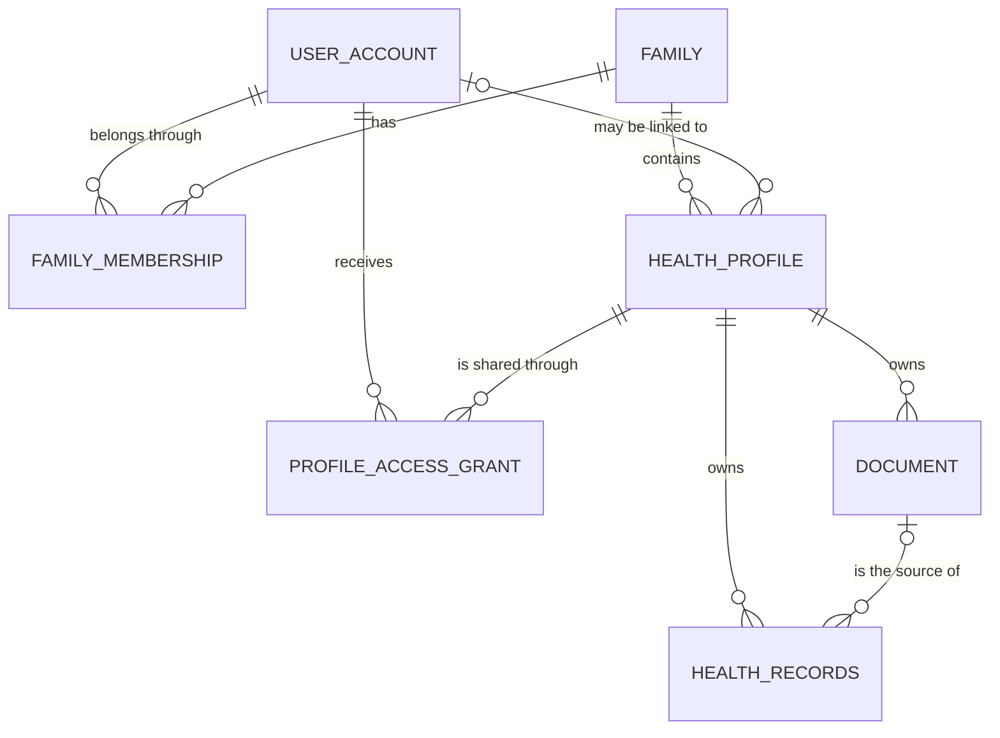

# Family Health Companion
## Database Design — Draft v0.1

**Status:** DRAFT for review. Not approved and not an implementation requirement until reviewed.
**Implementation state:** Nothing in this document has been implemented.
**Based on:** `01-problem-statement.md`, `02-srs.md` (MVP v0.2), `03-system-design.md` (v0.1), `CLAUDE.md`.

Items marked **[Proposal]** go beyond what the source documents state. Questions for the reviewer are in section 10.

## 1. Conventions

| Topic | Rule |
|---|---|
| Database | PostgreSQL 18 |
| Schema changes | Flyway migrations only. Hibernate runs with `ddl-auto=validate` and never changes the schema. |
| Destructive migrations | Require explicit approval (`CLAUDE.md` section 5) |
| Primary keys | `uuid`, so record IDs in URLs cannot be guessed or counted |
| Naming | `snake_case`, singular table names |
| Audit columns | `created_at`, `updated_at` as `timestamptz NOT NULL` on every mutable table |
| Concurrency | `version bigint` on tables edited by users (JPA optimistic locking) |
| Enumerations | `text` with a `CHECK` constraint, mapped with `@Enumerated(EnumType.STRING)` |
| Foreign keys | Always declared and indexed |
| Dosages and results | Stored as recorded. Never normalized in a way that changes the meaning. |

### 1.1 Dates on health events [Proposal]

The SRS requires date and time "where available", so a health event may have only a date, or no date at all.

- `occurred_on date NULL` and `occurred_time time NULL` hold the date and time as the user recorded them, without time zone conversion.
- `timestamptz` is used only for system events such as `created_at`.
- Records with no date appear in a labelled "Date unknown" group on the timeline. The system never substitutes the upload or entry date.

### 1.2 Record provenance [Proposal]

Every confirmed health record carries:

| Column | Meaning |
|---|---|
| `source_type` | `USER_REPORTED` or `DOCUMENTED` |
| `source_document_id` | Nullable FK to `document`. Required when `source_type = 'DOCUMENTED'`. |
| `source_document_deleted_at` | Nullable `timestamptz`, set when the user deletes the source document |
| `extraction_draft_item_id` | Nullable FK, set when the record came from an approved AI draft |
| `created_by` | The account that entered or approved the record |

The rule is enforced with a `CHECK` constraint:
`source_type <> 'DOCUMENTED' OR source_document_id IS NOT NULL OR source_document_deleted_at IS NOT NULL`.

`DOCUMENTED` means "taken from an attached document". It does not mean the document was verified, because verification is excluded by SRS section 8. `AI_GENERATED` is deliberately not a value here: AI-generated content lives in `extraction_draft_item` until approved, and in `health_summary` and `saved_recipe`, which are labelled as AI output.

## 2. Ownership model

Health profiles are separate from login accounts (`CLAUDE.md` section 5).

Every profile-owned table has `profile_id uuid NOT NULL` referencing `health_profile`, except direct children of a profile-owned table, which inherit ownership through their parent. Those are listed explicitly below.

## 3. Identity and family

### `user_account`
| Column | Type | Notes |
|---|---|---|
| `id` | uuid | PK |
| `email` | text | NOT NULL, UNIQUE, stored lowercase |
| `password_hash` | text | NOT NULL |
| `display_name` | text | NOT NULL |
| `status` | text | `ACTIVE`, `DISABLED` |

### `family`
| Column | Type | Notes |
|---|---|---|
| `id` | uuid | PK |
| `name` | text | NOT NULL |
| `created_by` | uuid | FK `user_account` |

### `family_membership`
| Column | Type | Notes |
|---|---|---|
| `family_id` | uuid | FK, part of unique key |
| `user_account_id` | uuid | FK, part of unique key |
| `role` | text | `MANAGER`, `MEMBER` |

### `health_profile`
| Column | Type | Notes |
|---|---|---|
| `id` | uuid | PK |
| `family_id` | uuid | FK, NOT NULL, indexed |
| `linked_account_id` | uuid | FK `user_account`, NULL for a dependent. The person's own account when one exists. |
| `full_name` | text | NOT NULL |
| `date_of_birth` | date | NULL |
| `is_dependent` | boolean | NOT NULL |

Unique: (`family_id`, `linked_account_id`). Sex, blood group, and government or insurance identifiers are deliberately not collected, because no MVP feature requires them (see Q3).

### `profile_access_grant` [Proposal]
| Column | Type | Notes |
|---|---|---|
| `profile_id` | uuid | FK, part of unique key |
| `user_account_id` | uuid | FK, part of unique key, indexed |
| `level` | text | `VIEW`, `EDIT`, `MANAGE` |
| `granted_by` | uuid | FK `user_account` |

Grants are the only source of access to a profile. See `06-security-and-ai-safety.md` section 3.

## 4. Health records

All tables in this section have `profile_id` and the provenance columns from section 1.2.

| Table | Main columns |
|---|---|
| `condition` | `name` NOT NULL, `status` (`ACTIVE`, `RESOLVED`, `UNKNOWN`), `onset_on`, `notes` |
| `allergy` | `allergen` NOT NULL, `reaction_as_recorded`, `severity_as_recorded`, `notes` |
| `dietary_restriction` | `kind` (`RESTRICTION`, `PREFERENCE`), `description` NOT NULL |
| `doctor_visit` | `occurred_on`, `occurred_time`, `doctor_name`, `facility`, `reason`, `notes` |
| `symptom_entry` | `description` NOT NULL, `severity_as_reported`, `occurred_on`, `occurred_time`, `notes` |

`emergency_contact` (`profile_id`, `name` NOT NULL, `relationship`, `phone` NOT NULL) has no provenance columns because it is not a health record.

`allergy` and `dietary_restriction` are not named in the SRS Health Records section or in any system design module, but the meal assistant and emergency card depend on them. This draft places them in Health Records (see Q2).

## 5. Medication and lab results

### `medication`
`profile_id`, provenance columns, `name` NOT NULL, `dosage_as_recorded`, `instructions_as_recorded`, `prescribed_by`, `start_on`, `end_on`, `status` (`ACTIVE`, `STOPPED`, `UNKNOWN`).

Dosage is free text so the system preserves what was recorded and cannot be read as recommending a dose.

### `medication_schedule` (owned through `medication`)
`medication_id` FK, `time_of_day` NOT NULL, `days_of_week` (`smallint[]`, NULL means daily), `time_zone` NOT NULL, `reminder_enabled` NOT NULL.

### `adherence_event` (owned through `medication`)
`medication_id` FK, `schedule_id` nullable FK, `scheduled_for timestamptz`, `status` (`TAKEN`, `SKIPPED`), `recorded_at` NOT NULL, `recorded_by` FK.

Unique: (`schedule_id`, `scheduled_for`), so one dose cannot be logged twice.

### `lab_result`
| Column | Type | Notes |
|---|---|---|
| `profile_id` | uuid | FK, NOT NULL |
| provenance columns | | Section 1.2 |
| `test_name` | text | NOT NULL, as recorded |
| `test_key` | text | NOT NULL, lowercase and trimmed `test_name`, used to group values for trends |
| `value_numeric` | numeric | NULL |
| `value_text` | text | NULL, for results like "Positive" |
| `unit` | text | NULL when missing from the source |
| `result_on` | date | NULL when missing from the source |
| `reference_range_as_printed` | text | NULL, display only |

`CHECK (value_numeric IS NOT NULL OR value_text IS NOT NULL)`.

`CLAUDE.md` asks for explicit units and dates, and SRS 3.6 requires missing ones to be flagged. This draft reconciles them as follows: both columns are explicit and nullable, the UI flags a missing value, and unit or date is never guessed.

Values are comparable in a trend only when `test_key` and `unit` match exactly, and `value_numeric` and `result_on` are present. No unit conversion takes place.

## 6. Documents and AI

### `document`
`profile_id`, `uploaded_by`, `original_filename`, `content_type`, `size_bytes`, `sha256`, `storage_key` (UNIQUE, random, contains no personal data), `category` (`LAB_REPORT`, `PRESCRIPTION`, `SCAN`, `OTHER`), `document_on`, `extraction_status` (`NOT_REQUESTED`, `QUEUED`, `PROCESSING`, `READY_FOR_REVIEW`, `FAILED`, `REVIEWED`).

The stored file is never altered by the system.

### `extraction_job` (owned through `document`)
`document_id`, `status`, `attempts`, `provider`, `model`, `prompt_version`, `error_code`, `started_at`, `finished_at`.

The job table doubles as a simple database-backed queue. No message broker is needed for the prototype.

### `extraction_draft` (owned through `document`)
`document_id`, `job_id`, `schema_version`, `status` (`PENDING_REVIEW`, `COMPLETED`, `REJECTED`), `reviewed_by`, `reviewed_at`.

### `extraction_draft_item` (owned through `extraction_draft`)
`draft_id`, `item_type` (`MEDICATION`, `LAB_RESULT`, `CONDITION`, `ALLERGY`, `DOCTOR_VISIT`), `payload jsonb`, `status` (`PENDING`, `APPROVED`, `REJECTED`), `confirmed_record_id`.

Per-item status allows partial approval. Draft data stays out of the confirmed record tables until the user approves it, so a query on those tables can never return unapproved AI output.

### `ai_usage_event`
`user_account_id`, `feature`, `occurred_at`, `input_tokens`, `output_tokens`, `outcome`. Used for usage limits. Contains no prompt or response text.

## 7. Food, meals, summaries, emergency card, and audit

| Table | Main columns |
|---|---|
| `food_log_entry` | `profile_id`, `description` NOT NULL, `meal_type`, `occurred_on`, `occurred_time`, `saved_recipe_id` nullable FK |
| `saved_recipe` | `profile_id`, `created_by`, `title`, `ingredients jsonb`, `steps jsonb`, `mode` (`GENERAL`, `HEALTH_AWARE`), `prompt_version` |
| `health_summary` | `profile_id`, `generated_by`, `content`, `period_from`, `period_to`, `source_refs jsonb`, `provider`, `model`, `prompt_version` |
| `emergency_card` | `profile_id` UNIQUE, `enabled`, `token_hash` UNIQUE, `token_rotated_at` |
| `emergency_card_item` | `card_id`, `item_type`, `display_text`, `display_order` |
| `audit_event` | `occurred_at`, `actor_account_id` nullable, `action`, `target_type`, `target_id`, `profile_id` nullable, `outcome`, `metadata jsonb` |

Notes:

- **`emergency_card_item` stores approved text, not references [Proposal].** The card can only show what the user explicitly approved. An edit to a record cannot silently change or expand a public card. The UI flags when a source record has changed.
- **Only a hash of the emergency token is stored.** A database leak does not reveal working links.
- **`audit_event` is append-only and holds no health details.** Its actor and target references are deliberately not foreign keys, so the history outlives deleted records.

## 8. Indexes and deletion

### Indexes
- `(profile_id, occurred_on DESC)` on every table that appears on the timeline.
- `(profile_id, test_key, unit, result_on)` on `lab_result` for trends.
- `(status, created_at)` on `extraction_job` for the worker.
- `(user_account_id)` on `profile_access_grant` to list a user's profiles.
- `(profile_id, occurred_at DESC)` and `(actor_account_id, occurred_at DESC)` on `audit_event`.

### Deletion [Proposal]
The source documents require preserving originals and also providing a way to delete demo records and files. This draft treats these as compatible:

- The system never deletes or alters an original on its own, including when extraction fails.
- An explicit user delete is a hard delete of the record, and for a document, of the stored file too.
- Deleting a document does not delete records already confirmed from it. The service clears `source_document_id` and sets `source_document_deleted_at` in the same transaction, and the UI shows "source document deleted".
- Deleting a profile removes all of its records and files, and writes an audit event.
- Demo reset is a separate, demo-only operation (see `08-deployment-guide.md`).

## 9. Migration plan

Migrations arrive with the phase that needs them, rather than as one schema up front.

| Phase | Migration content |
|---|---|
| 1 | `V1` baseline, no domain tables |
| 4 | `user_account`, session tables, `audit_event` |
| 5 | `family`, `family_membership`, `health_profile`, `profile_access_grant` |
| 6 | `condition`, `allergy`, `dietary_restriction`, `emergency_contact` |
| 7 | `doctor_visit`, `symptom_entry` |
| 8 | `medication`, `medication_schedule`, `adherence_event` |
| 9 | `lab_result` |
| 10 | `food_log_entry` |
| 11 | `document` |
| 12 | `extraction_job`, `extraction_draft`, `extraction_draft_item`, `ai_usage_event` |
| 14 | `saved_recipe` |
| 16 | `health_summary` |
| 17 | `emergency_card`, `emergency_card_item` |

Provenance columns exist from each table's first migration. Their foreign keys are added once the target table exists: `source_document_id` in Phase 11 and `extraction_draft_item_id` in Phase 12.

## 10. Questions for review

- **Q1. Permissions:** is the grant model in `06-security-and-ai-safety.md` section 3 what you want? This is the most important review item.
- **Q2. Allergies and restrictions:** do you agree they belong in Health Records? This adds them to the module list in `03-system-design.md`.
- **Q3. Blood group:** should it be collected? It is common on emergency cards, but no document requires it. This draft leaves it out to avoid unnecessary data collection.
- **Q4. Hard delete:** do you agree that deletes are permanent, with no recycle bin in the prototype?
